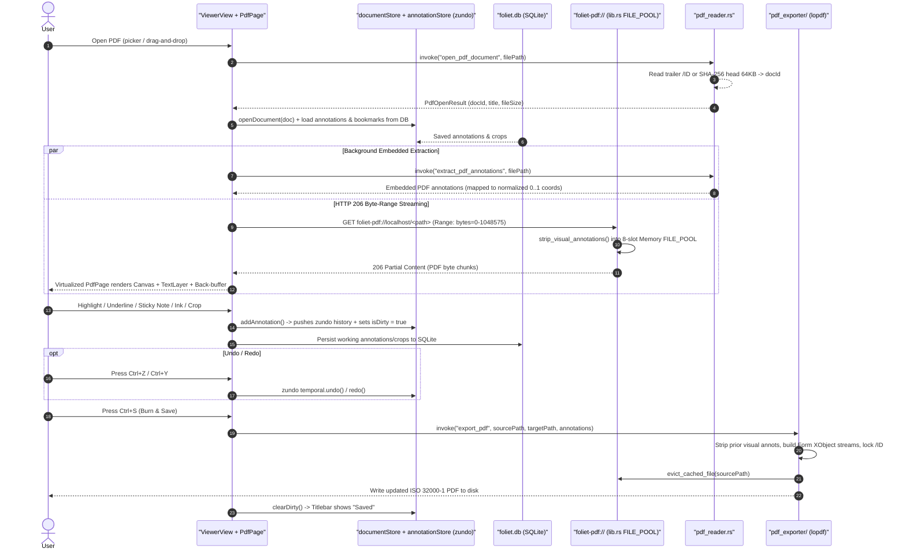

# 02 — PDF Streaming & ISO 32000-1 Annotation Burning

This sequence diagram shows how Foliet opens large PDFs without loading them into IPC memory, renders pages virtually, tracks edits with `zundo`, and burns annotations back into the PDF file with Rust `lopdf`.

