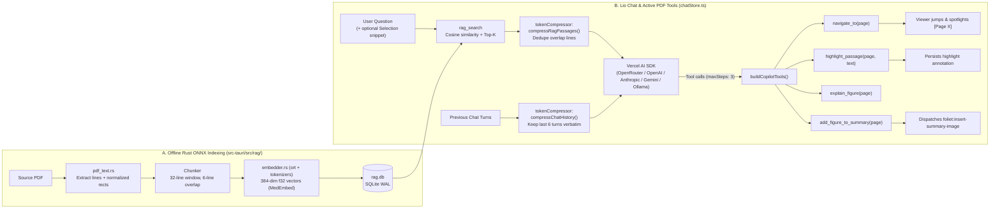
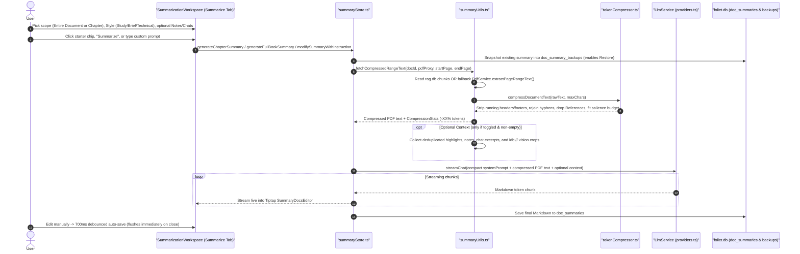

# 03 — AI Copilot, Offline Rust ONNX RAG & Summary Compression

This diagram covers two core AI workflows:
1. **Offline Rust ONNX RAG + Lio Copilot Tool Execution**
2. **Zero-Highlight Summary Studio + Token Compressor Pipeline**

