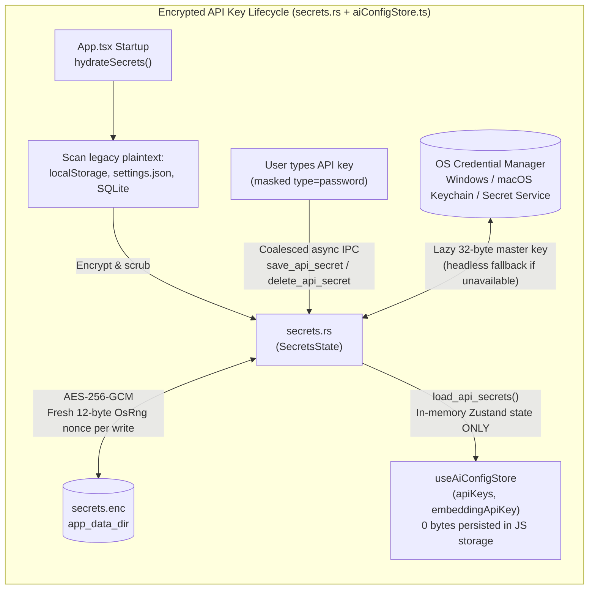
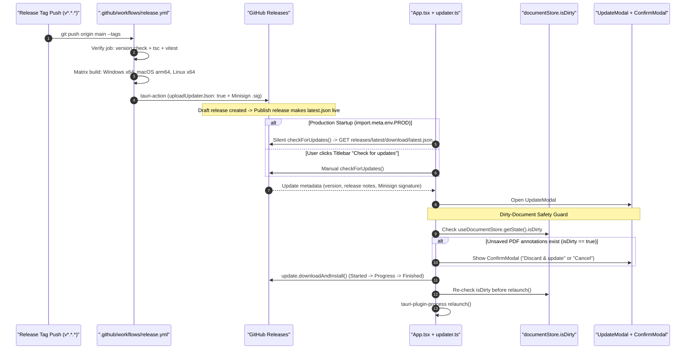

# 04 — Encrypted Secrets Vault & Signed Auto-Updater

This diagram illustrates how Foliet keeps API keys out of plaintext storage (`localStorage` / `settings.json` / SQLite) and how signed releases flow from GitHub Actions to the in-app updater with a dirty-document safety guard.

